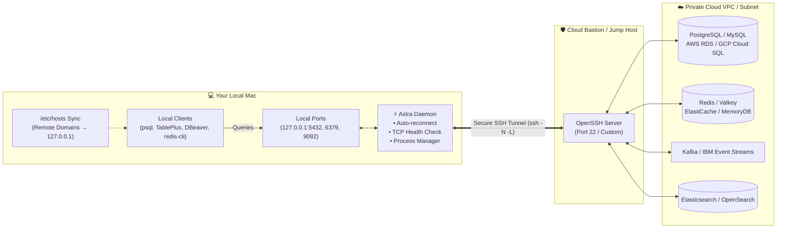

<div align="center">

# ⚡ Astra

### The Native macOS SSH Tunnel & Bastion Jump Host Manager

[](https://github.com/pankaj-kumar34/astra/releases)
[](https://github.com/pankaj-kumar34/astra/actions)
[-black?style=flat-square&logo=apple)](https://github.com/pankaj-kumar34/astra/releases)
[](https://golang.org)
[](https://v3.wails.io)
[](LICENSE)
[](CONTRIBUTING.md)

<p align="center">
  <b>Connect to private cloud databases and VPC microservices through bastion/jump hosts with one click.</b><br>
  Featuring automatic reconnection, live TCP health probing, local port collision auto-freeing, native Touch ID <code>/etc/hosts</code> sync, and zero cloud telemetry.
</p>

[**Download Latest Release (.dmg)**](https://github.com/pankaj-kumar34/astra/releases/latest) • [**Features**](#-features) • [**Quick Start**](#-quick-start) • [**Comparison**](#-astra-vs-manual-terminal-ssh) • [**Architecture**](#-architecture)

</div>

---

## 📌 Overview

**Astra** is a fast, lightweight, native macOS desktop application designed for software engineers, DevOps, SREs, and database administrators who regularly interact with isolated cloud infrastructure across **AWS, GCP, Azure, IBM Cloud**, or on-premise private datacenters.

Instead of managing brittle terminal windows running background `ssh -N -L` scripts, wrestling with orphaned processes that block local ports, or paying for heavy proprietary tools, Astra provides a clean, native macOS experience with production-grade reliability:

- 🚀 **Connect in one click** to remote PostgreSQL, Redis, Valkey, Kafka, Elasticsearch, or custom ports.
- 🔄 **Self-healing tunnels** with exponential backoff retry on laptop sleep, network drop, or Wi-Fi changes.
- 🩺 **Active TCP port health probers** confirming that forwarded services are actually reachable.
- 🧹 **Automatic port freeing** preventing `bind: address already in use` errors by killing lingering processes.
- 🌐 **Seamless `/etc/hosts` synchronization** enabling you to access remote hosts by their real internal domain names.
- 🔒 **100% Local & Private** — your SSH keys, credentials, and configurations never leave your machine.

---

## 🏗️ Architecture



---

## ✨ Features

### 🚀 Profile-Based Multi-Environment Management
Organize all your bastion servers and port-forward configurations by environment (e.g., `Dev`, `Staging`, `Prod`, `Analytics VPC`). Duplicate profiles with a single click to set up new environments in seconds.

### ⚡ One-Click Connect & Disconnect
No more memorizing complex OpenSSH command flags (`-N -L`, `-o ExitOnForwardFailure=yes`, `-o ServerAliveInterval=15`). Click **Connect** and Astra orchestrates the tunnel in the background.

### 🔄 Intelligent Auto-Reconnect
When your laptop wakes from sleep, changes Wi-Fi networks, or encounters transient network jitter, Astra detects tunnel drops and retries with an exponential backoff schedule (**5s → 15s → 30s**) to restore connections seamlessly.

### 🩺 Real-Time TCP Port Health Prober
Checking whether an SSH process is running isn't enough. Astra periodically TCP-dials each active forwarded port every 30 seconds to verify end-to-end connectivity to the target service, displaying live color-coded status badges:
- 🟢 **Healthy** — Service is active and accepting connections
- 🟡 **Connecting / Retrying** — Establishing connection or re-negotiating
- 🔴 **Unreachable** — Port is unreachable or remote service is down

### 🛡️ Automatic Port Freeing
Never see `bind [127.0.0.1]:5432: Address already in use` again. When starting a tunnel, Astra automatically identifies and terminates stale processes holding your specified local ports.

### 🌐 Native Touch ID `/etc/hosts` Domain Mapping
Access private services using their authentic VPC hostnames (e.g., `db.internal.vpc.company.com`) rather than rewriting code or connection strings to `localhost`. Astra syncs necessary `/etc/hosts` mappings via native macOS authorization prompts (Touch ID / Admin password) and tags every entry so deletions are clean and non-destructive.

### 📦 Pre-configured Service Presets
Includes rapid-entry presets for standard cloud infrastructure:
| Preset | Default Local Port | Default Remote Port |
| :--- | :--- | :--- |
| **PostgreSQL** | `5432` | `5432` |
| **Redis** | `6379` | `6379` |
| **Valkey** | `6379` | `6379` |
| **Elasticsearch** | `9200` | `9200` |
| **IBM Event Streams / Kafka** | `9092` / `9093` | `9092` / `9093` |
| **Custom Service** | Any | Any |

### 📜 Live Real-Time Log Streaming
Inspect real-time SSH stderr diagnostics directly from the UI. Astra captures and color-codes log output (with a rolling buffer of 500 lines) to help troubleshoot key mismatches, network timeouts, and authentication errors instantly.

### 🔔 Native macOS Integration
- **Dock & Window Management**: Closing the app window cleanly hides it to the background while active tunnels remain alive. Re-clicking the dock icon brings it straight back.
- **Native Notifications**: Receive system banner alerts with audio chimes via Apple's `UNUserNotificationCenter` when tunnels connect, disconnect, or recover.

### 🔒 100% Local & Privacy-First
Astra does not require an account, has zero cloud dependencies, and collects **zero telemetry or analytics**. Your SSH private keys, credentials, and host configurations reside exclusively on your machine at `~/Library/Application Support/Astra/data.json`.

---

## 📊 Astra vs. Manual Terminal SSH

| Capability | Astra | Manual Terminal `ssh -N -L` |
| :--- | :---: | :---: |
| **Profile Management** | Saved per environment & service | Manual bash scripts / aliases |
| **One-Click UI Control** | Instant toggle from Dock / Window | Background process handling |
| **Active TCP Health Probing** | Periodic dial to verify service is up | Blind process existence only |
| **Connection Recovery** | Automatic retry with 5s/15s/30s backoff | Manual restart on Wi-Fi drop |
| **Port Conflict Handling** | Kills conflicting process before connect | `bind: address already in use` error |
| **Domain Resolution** | Syncs `/etc/hosts` automatically | Manual `sudo vi /etc/hosts` editing |
| **Diagnostics** | Real-time structured log view | Stderr pipe or nohup log file |
| **macOS Native Alerts** | Banner & chime on state changes | None |

---

## 📥 Installation

### Download Pre-built DMG (Recommended)
Grab the latest universal binary (compatible with both **Apple Silicon M1/M2/M3/M4** and **Intel x86_64** Macs):

1. Head to [**Releases**](https://github.com/pankaj-kumar34/astra/releases/latest).
2. Download `Astra-<version>-macOS-universal.dmg`.
3. Open the disk image and drag **Astra** into your **Applications** folder.

> **Note**: Because Astra is packaged as an independent open-source binary, upon first launch macOS Gatekeeper may prompt verification. You can right-click the app and choose **Open**, or allow it in *System Settings → Privacy & Security*.

---

## 🚀 Quick Start

1. **Create a Bastion Profile**
   - Click **+ New Profile** in the sidebar.
   - Enter your bastion connection details:
     - **Profile Name**: e.g., `AWS Production VPC`
     - **Bastion Host**: `bastion.prod.example.com`
     - **SSH User**: `ec2-user` or `ubuntu`
     - **SSH Key**: Browse your local key (e.g., `~/.ssh/id_rsa` or `~/.ssh/id_ed25519`).
2. **Add Port Forwards**
   - Click **Add Port Forward**.
   - Select a preset (e.g., **PostgreSQL**) or enter a custom service name.
   - Specify:
     - **Local Port**: e.g., `5432`
     - **Remote Host**: e.g., `aurora-db.internal.prod.aws`
     - **Remote Port**: e.g., `5432`
3. **Connect**
   - Hit **Connect**.
   - Astra runs the tunnel, clears port collisions, verifies TCP health, and presents a 🟢 green indicator once verified.
4. **Query Your Database**
   - Open your favorite tool (**TablePlus**, **DBeaver**, **pgAdmin**, or terminal client):
     ```bash
     psql -h 127.0.0.1 -p 5432 -U postgres -d my_database
     ```

---

## ⚙️ Configuration & Storage

Astra stores all configured profiles in human-readable JSON format at:
```
~/Library/Application Support/Astra/data.json
```

### Example Data Structure
```json
{
  "profiles": [
    {
      "id": "prod-vpc-9182",
      "name": "Production Aurora Cluster",
      "host": "bastion.company.com",
      "port": 22,
      "user": "cloud-user",
      "keyPath": "/Users/pankajkumar/.ssh/id_ed25519",
      "description": "Main production database bastion tunnel",
      "autoConnect": true,
      "forwards": [
        {
          "id": "fwd-pg-01",
          "label": "PostgreSQL Main",
          "service": "postgres",
          "localPort": 5432,
          "remoteHost": "postgres-prod.internal.vpc",
          "remotePort": 5432
        },
        {
          "id": "fwd-redis-02",
          "label": "Cache Cluster",
          "service": "redis",
          "localPort": 6379,
          "remoteHost": "redis-prod.internal.vpc",
          "remotePort": 6379
        }
      ]
    }
  ]
}
```

You can easily version-control, backup, or sync this file across workstations.

---

## 🛠️ Development & Building from Source

### Prerequisites
- **macOS** 12.0 (Monterey) or newer
- **Go** 1.24+ (developed on Go 1.26)
- **Node.js** 20+ and **npm**
- **Wails v3 CLI**:
  ```bash
  go install github.com/wailsapp/wails/v3/cmd/wails3@latest
  ```

### Development Mode (Hot-Reload)
Run the application with live frontend hot-reload:
```bash
# Clone the repository
git clone https://github.com/pankaj-kumar34/astra.git
cd astra

# Start dev mode
wails3 task dev
```

### Production Build
```bash
# Package styled .dmg directly (single command)
wails3 task darwin:package:dmg

# Or package a universal binary (arm64 + amd64)
wails3 task darwin:package:universal && wails3 task darwin:create:dmg
```
Compiled artifacts are located in the `bin/` directory.

### Running Tests
```bash
# Go unit tests
go test -v ./...

# Frontend type check & build
cd frontend && npm run build
```

---

## 🤝 Contributing

We welcome issues and pull requests to make Astra better for the developer community.

- **Found a bug or need a feature?** Please open a GitHub issue with reproduction steps.
- **Submitting changes?** Ensure Go tests (`go test ./...`) and frontend build (`npm run build`) pass cleanly before submitting your PR.
- Follow conventional commit style (e.g., `feat:`, `fix:`, `docs:`) so release notes and version tags generate smoothly.

---

## 📄 License

Distributed under the **MIT License**. See [`LICENSE`](LICENSE) for more information.

---

## 👨‍💻 Author

Created by [**Pankaj Kumar**](https://github.com/pankaj-kumar34). Feedback, issue reports, and pull requests are warmly welcome!
